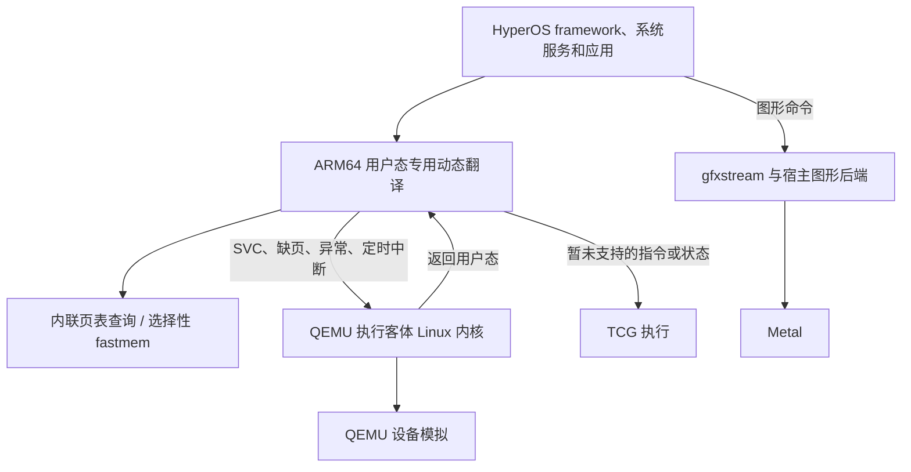

# HyperOS 3 在 iPhone 上的执行架构调研

日期：2026-10-07。目标是在 iPhone 17、iOS 27.2 上，通过 Husk 本地运行完整
HyperOS 3，并大幅改善持续交互速度与发热。本文记录源码核对、镜像检查和待验证
设计；性能实测沿用 [性能记录](hyperos3-performance.md)。

## 当前判断

实现进展与本机测试见 [开发进展](execution-progress.md)。M6～M8 已加入 MOPS
短复制、指针认证结果复用、间接尾调用和独占访问。原装 Bionic 的 64 字节复制
循环在 Mac 上从 TCG 的 10.895 ms 降到 Direct 的 1.555 ms，填充从 10.031 ms
降到 2.829 ms。完整系统的收益仍不稳定：M7 在 201.776 秒确认启动，设置冷启动
仍需 24.886 秒；M8 的下一轮启动出现退步，正在排查。新安装默认关闭 Direct，
内核 Direct 实验继续关闭。手机上的已测版本仍未达到基础可用性。

gfxstream GLES → ANGLE Metal 已完成 Mac 上完整 HyperOS 验证，iOS 图形库、
QEMU 和应用已构建。单核 TCG 的固定绘制中位数为 10.960 ms/帧；两轮设置
冷启动分别约 96 秒和 174 秒，后者已使用 ART speed 产物。M7 的固定绘制十帧
平均 3.051 ms/帧，手机端验证尚未完成。后续继续处理执行切换、代码编译和客体
内核耗时，分别记录局部循环、完整启动和真实界面操作的结果。

继续做架构原型有技术依据。缺少 HVF 会限制现成的硬件虚拟化路径，但用户态
ARM64 指令仍可通过 JIT、专用动态翻译或受控的直接执行运行。已有模拟器实现了
其中一些部件。完整 Android 所需的多进程内存、异常与内核协作仍需要开发和验证。

两条实现方向为：QEMU 保留 Linux 内核和设备模拟，Android 用户态增加专用
ARM64 执行后端；GLES 命令通过 gfxstream 在宿主 GPU 执行。
两者都保留 Android framework、系统服务、应用及客体 Linux 内核。

本次没有查到可直接集成、并已在普通侧载 iPhone 上验证完整 Android 大幅提速的
实现。现有资料支持开展原型；目前无法承诺整机提速倍数或持续流畅程度。投入
规模只记录为工程成本，各路径按正确性、平台限制和实测收益决定是否继续。

## 已核对的实现

| 实现 | 源码中的具体行为 | 对本项目的适用范围 |
| --- | --- | --- |
| Dynarmic ARM64 后端 | 生成 ARM64 代码；访存支持内联页表查询、fastmem 和失败回退 | 可研究为 Android 用户态后端；README 明确仅模拟用户态，另有浮点、非对齐和独占访问语义限制，接入前须补齐相关行为 |
| Strato NCE | 修改 SVC、TLS 和计数器访问，进入宿主处理函数；安装信号处理器 | 可参考执行切换与指令修补；其系统调用由 Switch 服务实现处理，本项目需要进入客体 Linux |
| MeloNX 的 NCE-New 分支 | `NceThreadPal`、`NceCpuContext`、`NcePatcher` 有 iOS/macOS 分支 | 仅作为移植线索；本次没有构建、运行，也未确认该分支的可用程度 |
| DolphiniOS fastmem | 作者记录过在满足内存条件的未越狱设备上使用 fastmem | 说明 iOS 用户态映射值得验证；2020 年该实现有完整 MMU 游戏限制，当前设备仍须实测 |
| gfxstream | GLES/Vulkan 命令转发；Apple 分支包含 Metal surface 相关处理 | 已实现 iOS 无窗口 GLES 后端，Mac 完整 HyperOS 已使用 Metal；手机性能待验证 |
| Husk JIT | RX/RW 双映射、预分配代码池；手机日志中执行自检返回 42 | 具备运行生成代码的基础；其他地址范围的映射和故障恢复尚待测试 |

源码按提交固定，下载文件位于 `work/performance/architecture-research/`：

- [Dynarmic](https://github.com/azahar-emu/dynarmic/tree/a46601580d5512d324104f985b5f0209dc980ddc)：
  `src/dynarmic/backend/arm64/emit_arm64_memory.cpp` 的
  `InlinePageTableEmitVAddrLookup`、`FastmemEmitVAddrLookup` 和读写回退。
- [Strato](https://github.com/strato-emu/strato/blob/ae1566a48285816a87e81d4aeb40bd2f4e56e60b/app/src/main/cpp/skyline/nce.cpp)：
  `SvcHandler`、信号处理和指令修补。
- [MeloNX 研究分支](https://github.com/bixinwei/melonx/tree/6d34f5bd65037983b8c5ae2111e11e3aecfa1fe6/src/Ryujinx.Cpu/Nce)。
- [gfxstream](https://github.com/google/gfxstream/tree/07ee40efb0e7037a9a9b7fe59071e7c4997e7cbe)：
  `host/CMakeLists.txt`、`host/native_window/native_sub_window_cocoa.mm`。
- [DolphiniOS 3.1.1 作者说明](https://oatmealdome.me/blog/dolphinios-ver-3-1-1/)。
- 本地 `src/ios-jit/husk-ios-jit.c` 的预分配、`vm_remap`、`vm_protect` 与执行自检。

## 路径一：完整系统中的 ARM64 用户态专用后端

设计如下。箭头表示执行切换或图形命令传递，所有部件均运行在 iPhone 内。

系统调用、Binder、进程管理和文件系统继续由客体 Linux 提供。新后端处理普通
用户态指令，并在需要内核服务时保存完整状态、注入对应异常。QEMU 完成内核
执行后，再由新后端继续运行。这需要修改执行循环和 ARM 状态转换；直接替换
一个动态库无法完成接入。

首个原型采用专用动态翻译和软件页表。普通计算尽量生成简短的 ARM64 代码，
访存保留检查与回退。之后只对可正确映射的区域启用 fastmem。这个顺序允许先
验证执行收益，同时保留处理 4 KB 页、多进程及权限变化的方法。

纯 NCE 可作为后续实验：普通指令直接执行，仅改写特定指令与控制转移。它对
客体地址与宿主映射的一致性要求更高；指令来自 ELF、ART JIT 和动态加载代码，
均须纳入处理。当前优先验证能够重写访存指令的后端。

### 必须解决的行为

| 问题 | 具体要求 | 可验证的处理方式 |
| --- | --- | --- |
| 多进程地址空间 | 两个 Android 进程可使用同一虚拟地址并指向不同物理页；多个 vCPU 可同时运行这些进程 | 起步使用每个地址空间独立的页表描述；代码缓存带地址空间及映射版本信息。fastmem 再比较独立映射区域与选择性映射 |
| 地址范围 | Android 虚拟地址可能远大于实际 RAM；完整 fastmem 区域可能超过 iOS 可保留范围 | 测量进程可用虚拟地址范围；软件页表使用稀疏结构；大范围线性映射作为可选优化 |
| 异常精度 | SVC、缺页和中断发生时，要恢复正确的客体 PC、寄存器与内核异常状态 | 显式切换点、宿主 PC 到客体状态的恢复信息；先验证单 vCPU 的进入与返回 |
| 页权限与代码修改 | 客体改变页表、权限或 JIT 代码后，其他线程不能继续使用旧映射和旧代码 | 与 QEMU 的 TLB、代码失效及跨核同步协作；记录失效原因与频率 |
| ARM64 ABI 与功能 | TLS、x18、FPCR/FPSR、独占访问、PAC、带标签地址及 CPU 扩展可能存在差异 | 控制客体公开的 CPU 功能；虚拟化相关状态；未支持的状态交给 TCG |
| iOS 代码执行权限 | JIT 开启并脱离调试器后，需要继续安全生成和执行代码 | 先复用 Husk 已验证的 RX/RW 代码池；新增可执行映射另测 |
| 持续调度 | 快速用户态代码必须及时返回，以处理客体中断、停止请求和线程同步 | 在生成代码中设置可退出点；测量频率对延迟与吞吐的影响 |

这些项目属于原型的验收条件。实现成本大，仍有明确的分步验证入口。

## 路径二：内存快速访问与客体内核配合

fastmem 将合适的客体内存映射到宿主地址，减少每次 load/store 的软件地址转换。
宿主页权限可辅助识别异常访问，不能直接覆盖 Android 的全部页表语义。错误
处理必须回到客体权限、异常和内存一致性规则。

### 本次镜像检查

对 `work/hyperos3-package/work/system.img` 使用只读 `debugfs cat`，解析
ELF64 的 `PT_LOAD`。没有导出完整分区或修改镜像。结果保存在
`work/performance/architecture-research/hyperos-elf-alignment.json`。

| 客体文件 | 加载段的 `p_align` | 按 16 KB 页取整后，不同权限段共享页面 |
| --- | --- | --- |
| `/system/bin/app_process64` | 4 KB | 存在 |
| `/system/bin/surfaceflinger` | 4 KB | 存在 |
| `/system/bin/init` | 4 KB | 存在 |
| `/system/lib64/libbinder.so` | 4 KB、64 KB | 存在 |
| `/system/lib64/libhwui.so` | 2 MB | 未发现 |
| `/system/lib64/libandroid_runtime.so` | 4 KB | 存在 |
| `/system/lib64/libEGL.so` | 4 KB | 存在 |
| `/system/lib64/libgui.so` | 4 KB、64 KB | 存在 |

这 8 个样本的加载段文件偏移和虚拟地址，在模 16 KB 的意义下均一致。不过，
段边界和权限仍需处理。样本检查尚不足以判定某个 ELF 在 16 KB 客体上的运行
兼容性；APEX、厂商库、应用和硬编码页大小也需要检查。

现有客体日志记录 5120 MiB、1310720 个内存页，两者对应 4 KB 页。Apple 平台
文档描述了 iOS 的 16 KB 用户空间页面；原型还应在这台手机调用 `getpagesize()`
记录实际值。一个 16 KB 宿主页无法同时表达四个任意映射、权限独立的 4 KB
客体页。改变客体页大小能够减少这类冲突，但仍须处理多进程与 JIT。

可依次验证三种做法：

1. **保留 4 KB 客体页，使用软件页表。** 先测量专用后端的计算和访存收益。
2. **选择性 fastmem。** 仅对物理映射连续、权限兼容的区域启用；其他区域回到
   页表查询。记录覆盖比例、缺页处理频率和映射更新成本。
3. **配合修改客体 Linux。** 通过明确接口通知地址空间切换、映射变化和代码
   失效；必要时调整映射布局与页分配。16 KB 内核另作镜像兼容实验。

客体通知用于减少重复发现映射变化的工作。宿主仍须校验通知和失效次序，
保留故障处理。先限定一个 vCPU、一个地址空间验证，再扩展并发。

E5 的实际代码显示，`husk_direct_run` 每次进入都会清空代码入口表和数据映射；
`code_page` 命中缓存时仍比较整页 4,096 字节。这些检查处理了进程切换、代码
修改与写别名，但频繁退出后会重复执行。下一步的 CPU 架构实验应先连接
QEMU 的 TLB 与代码失效通知，再测量跨执行片段复用映射和代码入口的收益。

具体实现需要覆盖 `tlb_flush_by_mmuidx_async_work`、页面及范围失效、写保护
变化、地址空间切换和设备写入。仅监听 TCG 翻译块失效仍不足：只由 Direct
执行的代码页也必须加入写保护和失效管理。应先实现保守的失效代数，再按测量
决定是否细分到页；确认正确性后再开展 16 KiB 内核或选择性 fastmem 实验。
这部分目前为待实现设计，尚无性能结果。

参考：[AOSP 16 KB 支持](https://source.android.com/docs/core/architecture/16kb-page-size/16kb)、
[Apple 虚拟内存说明](https://developer.apple.com/library/archive/documentation/Performance/Conceptual/ManagingMemory/Articles/AboutMemory.html)、
[扩展虚拟地址权限](https://developer.apple.com/documentation/bundleresources/entitlements/com.apple.developer.kernel.extended-virtual-addressing)。
权限声明是否在侧载签名后生效、可保留多大范围，均以手机上的调用结果为准。

## 路径三：图形协议与合成在宿主执行

原有 GPU 路径经过客体 Mesa/virgl、宿主 virglrenderer、ANGLE 和 Metal。
gfxstream 可将 GLES/Vulkan 命令交给宿主解码执行，减少客体驱动中由 TCG 执行
的工作。结合 Android HWC 协议，还可研究将图层合成操作移到宿主；SurfaceFlinger
的系统协调职责继续留在客体。

上游 gfxstream 的 Apple 构建链接 AppKit、QuartzCore、IOSurface，窗口代码
使用 `NSWindow`、`NSOpenGLView` 和 `CAMetalLayer`。G1 已加入 iOS 无窗口
surface 路径，并连接已有 ANGLE Metal。当前 QEMU 通过读回像素提供 scanout；
共享纹理及其同步仍需开发。Vulkan 可另行评估 MoltenVK 与设备功能兼容，
G1 限定 GLES。

QEMU 文档列出了 gfxstream GLES 和 composer 支持，并将相关参数标为实验性。
文档对应的主线版本与 Husk 当前 QEMU 10.0.12-utm 不同。G1 已构建 Rutabaga
后端，加入 AVD GLES 客体驱动，并在完整 HyperOS 中验证 virtio-gpu-pipe 传输。

固定 GLES 场景与像素、同步检查已通过，完整 HyperOS 的 SurfaceFlinger 已使用
Metal。后续继续比较客体 CPU、宿主 CPU、帧耗时和温度。已有 Metal 显示的旧构建也收到卡顿
反馈，因此收益应来自减少客体图形处理或等待时间，仍需实际占用数据支持。

参考：[QEMU VirtIO GPU](https://www.qemu.org/docs/master/system/devices/virtio/virtio-gpu.html)。

## 进一步改变执行方式

用户允许修改客体内核、执行后端与图形实现，不以改动工作量限制候选范围。
当前局部提速不足，接下来按可能消除的运行开销和平台条件安排实验。

### 2026-10-08 的实施优先级

| 方向 | 要消除的主要开销 | 需要联动修改的部分 | 当前进展与继续条件 |
| --- | --- | --- | --- |
| M：客体内核配合的直接访存与长段执行 | 逐次软件地址转换、重复校验、用户态与执行器之间的频繁切换 | 客体页表与地址空间通知、QEMU 失效处理、Direct 访存和异常恢复、必要时调整内核页大小及分配 | M2/M3 已实现分段共享映射、异常恢复和失效代次；Linux 权限、COW 与信号检查通过。指针遍历局部改善，完整 HyperOS 启动仍需约 16 分钟 |
| M4：批量内存操作 | 复制、移动、清零中的逐指令模拟与逐次软件访存 | QEMU 与 Direct 的批量接口、Bionic 调用、启动时能力声明 | 宿主及 Linux 测试通过；真实 Bionic 已使用 QEMU MOPS 宿主操作，全局替换未获收益，已停止部署 |
| M5：普通函数入口原生执行 | 间接调用后首条指令造成的 Direct/QEMU 切换 | BTYPE 状态、原生入口缓存、准确异常恢复 | 普通间接调用微基准较 TCG 约快 6.9 倍；修复入口续接后完整 HyperOS 在 804.439 秒确认启动 |
| M6～M8：长执行段中的函数边界、复制和锁操作 | MOPS、PAC、BR 和独占指令反复离开原生执行的开销 | 原生指令生成、QEMU 权限及认证、软件 exclusive monitor、入口 BTYPE | 宿主与完整 Linux 检查通过，真实 Bionic 短复制约为 TCG 的七分之一耗时。M7 整机有改善，M8 启动退步仍需定位 |
| M9/M10：SIMD 批量访存、计算与计数器切换 | 向量操作及计数器读取引发的回退 | 完整跨度检查、原生 SIMD、写回与异常状态、单条 TCG 切换 | 宿主与完整 Linux 检查通过；真实 Bionic 短复制约快 7.3 倍、短填充约快 9.8 倍、strlen 约快 3.3 倍。完整 HyperOS 仍慢，帧完成时间异常待排查 |
| M11：代码页回收与短入口编译 | 32 MiB JIT 空间整池清空、重复编译和短入口的整页扫描 | 按页持有生成区间、稳定入口表、跳转缓存与异常表失效、限制编译范围 | 14 项宿主检查及完整 Linux 检查通过；修复后的整机运行待完成 |
| N：Linux 内核原生运行 | 客体内核指令的 TCG 翻译、内核辅助函数及部分执行切换 | Linux 架构与宿主接口、进程调度、地址空间、系统调用进入和返回、Binder/futex/信号、设备接口 | 已核对 ARM64 UML 对 Linux 宿主的依赖；Darwin 完整内核原型尚未实现 |
| G：图形合成和显示传输 | 客体图形驱动工作、合成与 GPU 像素读回 | gfxstream、Android HWC/composer、共享纹理、fence、Husk Metal 显示 | GLES 已实现；composer 与共享纹理待做。需测量其占界面延迟的比例 |
| A：镜像构建时完成运行准备 | ART 解释执行和运行时编译、缺失硬件服务的重复尝试 | ART 编译产物与依赖清单、系统服务配置、镜像更新流程 | SystemUI 与设置已生成 speed 产物；服务裁减仍需按实际调用和占用决定 |

M 作为下一项 CPU 主线，N 保留独立的最小原型任务。G、A 与 CPU 改造可以结合。
M8 已扩大到固定 BTYPE 的 BR x16/x17，并复用同一执行片段内的指针认证结果。
现有整机数据仍未达到基础可用性；启动退步先做开关对照，再决定各项默认行为。

此前带统计的 E5 + G1 启动运行中，内核 TCG 占 vCPU 线程时间约 34.3%。若仅将
其余部分加速到耗时趋近于零，按该占比计算的 CPU 时间加速上限约为 2.91 倍。
这一计算只说明保留内核成本的限制：样本含统计开销，属于启动阶段，不能用于
预测桌面或手机性能。因此 N 值得研究，工作量不能作为排除它的理由。

M 的最小实现必须同时包含以下行为，单独增加映射缓存还不够：

1. 以地址空间标识及版本区分进程。页表、权限、代码和设备写入变化完成失效后，
   才能继续执行。初版限定一个 vCPU。
2. 对符合宿主页粒度的 RAM 建立共享映射；其他页面继续检查。代码写入别名、
   COW 和 MMIO 仍须回到正确的客体处理路径。
3. 为故障位置记录客体 PC 和寄存器恢复信息。宿主保护异常须转成客体异常，
   不能由宿主直接跳过故障指令。
4. 在长执行段保留可中断点，并同时测量映射更新、系统调用和进程切换成本。
   若地址空间切换时大量逐页 remap 抵消收益，应改用每进程窗口或分区映射。

M1 的只读采样显示，五个关键进程约 10%–18% 的驻留页初步满足 16 KiB
映射条件。现有 `6.12.81-4k` 内核已支持 mTHP：16 MiB 匿名分配实验中，
临时启用 16 KiB mTHP 后，候选比例达到约 85%–90%。因此先验证保留 4 KiB
用户接口的连续页分配，再决定是否需要 16 KiB 内核与 vendor 模块构建。
该变更还涉及 ELF 段权限、APEX、APK 内 native 库和硬编码页大小；现有八个 ELF
样本不足以确认兼容性。AOSP 的 16 KiB 支持可供实现参考，本项目的混合 HyperOS
镜像仍需单独验证。

N 的首个可运行产物应启动完整 Linux 的 init，并通过 fork/exec、COW、futex、
信号和文件读写，再加入 Binder 和 Android 启动。需要把宿主相关的 `clone`、
`ptrace`、seccomp 和线程状态访问替换为 Darwin 下的进程管理与受控执行接口。
用户态 SVC 仍进入这份客体 Linux；Android framework 和系统服务继续保留。
内核能够作为一个库初始化，尚不足以通过这个阶段。

### 下一阶段如何判断大改的收益

M2/M3 已实现一个 vCPU 下的分段内存窗口，首次映射、权限变化、COW 和代码
写入继续由 QEMU 处理。小型 Linux 的进程切换、代码修改与权限检查通过，完整
HyperOS 冷启动检查也已完成。后续按地址空间切换频率观察映射失效成本，
并通过 M5 减少普通调用的执行切换。M4 的真实 Bionic 对照未获得收益。
只有固定地址循环变快，仍不足以扩大到完整镜像。

已有原型测得逐页 remap 加权限设置平均约 1.5 微秒。若每次客体进程切换都重建
大量映射，这项成本会累积。因此需要比较保留各地址空间的映射窗口与共享窗口
两种做法。Mac 已成功保留单个 512 GiB 窗口；iOS 的可用范围、多个窗口的限制
和真实签名下的异常处理均待验证。若大范围窗口不可用，应验证分区映射，并
重新测量地址选择的指令开销。

G 的下一阶段保留 SurfaceFlinger 的系统协调职责，将合适的图层合成交给宿主，
并用共享纹理替代当前 GPU 读回、Pixman 传递和显示上传。验收包含图层变化、
旋转、fence 顺序、资源释放和持续显示；性能统计要区分客体 CPU、宿主 CPU、
GPU 与等待时间。绘制微测成功只能确认这条图形路径可执行。

N 使用独立原型验证完整 Linux 进程环境，避免先改动当前 HyperOS 的启动方式。
其目标同时覆盖用户态和内核执行成本，工程范围最大，平台限制尚未验证。
当原型能够运行 init 和上述进程测试后，再评估 Binder、Android framework
及现有 vendor 接口。现阶段不能给出它在 iPhone 上的提速倍数。

整机验收继续使用桌面滑动、设置冷启动、应用切换和持续运行。重做镜像时，
ART 产物校验与虚拟硬件服务配置应进入可复现的构建流程；服务调整需要先确认
实际等待或 CPU 占用，不能仅根据缺失 HAL 的日志数量决定删除哪些组件。

### 用户态直接执行与快速映射

普通 ARM64 指令尽量直接交给宿主 CPU，修改 SVC、TLS、PC 相对寻址及需要
接管的跳转；在返回客体内核、访问受限页面或发生中断时保存完整状态。计算
路径可以减少动态翻译中的中间表示、寄存器保存和块调度开销，数据访问则需要
有效的宿主映射。Strato 的 NCE 已实现部分指令修补、线程上下文与信号处理，
可参考其代码组织和切换方式。完整 Android 仍需自行完成与客体 Linux 的协作。

本机原生循环约 22.470 ms，当前 TCG 对照约 93.944 ms。这只能说明同一小型
计算循环仍有执行开销，不能推导完整 HyperOS 的加速倍数。下一步需要比较
多页代码、指针访问、系统调用和进程切换的结果。

iOS 接入需要先解决以下条件：

- 普通 ELF 与 ART 生成代码都进入现有 RX/RW 代码池；代码位置变化后仍保持
  客体的地址和间接跳转语义。
- 4 KiB 客体页与宿主页的映射、权限兼容。可研究 16 KiB 客体内核，先验证
  HyperOS 的 ELF、APEX 和厂商库，再决定是否调整镜像。
- 不同进程相同虚拟地址的映射隔离。单宿主进程内，原样地址访问需要随客体
  进程切换更新映射；若分配不同宿主区域，则必须重写地址访问。两种做法都
  应测量 Binder 等频繁跨进程活动中的成本。
- x18、TLS、浮点状态、独占访问、JIT 代码失效和可中断执行必须正确。

可修改客体内核，主动通知当前地址空间和页表变更，减少重复查询与不必要的
缓存清理。这项配合可与直接执行、选择性 fastmem 一同验证。完整 Android
framework、系统服务和客体 Linux 继续保留。

来源：[Strato NCE 源码](https://github.com/strato-emu/strato/blob/ae1566a48285816a87e81d4aeb40bd2f4e56e60b/app/src/main/cpp/skyline/nce.cpp)。

### 让客体内核在宿主用户空间执行

进一步的候选是将客体 Linux 的架构相关部分改成宿主用户空间实现，减少
内核指令的翻译开销。ARM64 User-Mode Linux 提供了新参考：项目记录了在
Linux/Android 宿主上启动 Alpine、Debian 和运行容器的结果，内核与用户程序
通过宿主进程、系统调用拦截和内存映射配合运行。本项目尚未构建或复现这些
结果，也未确认 HyperOS 兼容性。

核对的提交为 `8897487c52233cd00cf2850008ca068892f1ae91`。源码中的
`arch/um/os-Linux/skas/process.c` 使用 `clone()`、`ptrace()` 与 seccomp；
`arch/arm64/um/os-Linux/registers.c` 通过 `PTRACE_GETREGSET`、
`PTRACE_SETREGSET` 和 `NT_ARM_TLS` 读写线程状态。这些 Linux 宿主接口需要
在 iOS 上重新设计，增加一个编译目标无法完成移植。还需实现普通侧载应用
中的客体进程隔离、缺页处理、调度和 ARM64 代码执行。

Linux Kernel Library 可以将 Linux 代码链接进应用，但其项目说明也明确区分
了 UML 的完整进程环境与 LKL 的库接口。现成 LKL 尚不足以承担 HyperOS 所需
的完整多进程环境。复用它需要另行实现这些运行语义。

这条路线可能同时减少用户态和内核的翻译成本，平台与正确性风险最高。先验证
iOS 可提供的运行接口及最小完整 Linux，再决定是否转为主要实现。研究过程中
继续沿用现有 QEMU 原型验证进程、异常和内存行为。

来源：[ARM64 UML](https://github.com/zalexdev/linux-um-arm64/tree/8897487c52233cd00cf2850008ca068892f1ae91)、
[宿主执行循环](https://github.com/zalexdev/linux-um-arm64/blob/8897487c52233cd00cf2850008ca068892f1ae91/arch/um/os-Linux/skas/process.c)、
[LKL 项目说明](https://github.com/lkl/linux)。

### 图形命令与合成在宿主执行

gfxstream 与前两种 CPU 方向可以结合。目标是让 GLES 绘制、着色器处理及合适
的图层合成在宿主执行，减少客体中需要模拟的图形代码与数据复制。QEMU 已有
面向 Android 的实验性 GLES/composer 接口。G1 已实现 iOS GLES 后端与客体
驱动更新，composer 和共享纹理尚未接入。

若当前负载的大部分时间用于软件绘图或客体驱动，这一改变可能明显改善帧
耗时；具体占比尚待采样。旧构建使用过 Metal 图形路径仍收到卡顿反馈，因此
需要比较新协议减少了哪些客体工作，单独更换显示输出无法证明收益。

来源：[QEMU VirtIO GPU](https://www.qemu.org/docs/master/system/devices/virtio/virtio-gpu.html)。

## 镜像构建阶段的 ART 预编译

单独检查 boot image、system_server、SystemUI、桌面和设置的实际编译状态。
AOSP 的 `verify` 只验证 DEX；`speed` 预编译全部方法；`speed-profile` 预编译
profile 覆盖的方法并优化对应类加载。预编译产物依赖 boot classpath 等输入，
混合镜像需要核对运行时是否接受已有产物。

若存在大量解释执行，应将 AOT 生成、APK/JAR 摘要、ART/APEX 版本和依赖校验
加入镜像构建流程。开发机可以完成一次性预编译，日常启动直接加载镜像内产物。
需要测量额外存储、启动、交互和缺页成本；不能由 compiler filter 配置推断收益。
`g1-app-driver-check` 的 Settings 进程已加载 boot/framework OAT 与
`/data/dalvik-cache/arm64/system_ext@priv-app@Settings@Settings.apk@classes.dex`
中的可执行代码，并同时存在 JIT cache。boot image 已加载；各应用具体 compiler
filter 已进一步查询：SystemUI 为 `verify`、设置为 `speed-profile`、桌面为
`speed`。A1 已为前两者生成 ART 接受的 `speed` 产物，后续冷启动查询仍为
`speed`。完整界面收益继续验证，编译方法的实际运行占比尚未测量。

来源：[AOSP ART 配置](https://source.android.com/docs/core/runtime/configure)。

## 其他高投入方向

**将明确的计算任务交给宿主函数。** 例如用共享缓冲区提交压缩、解压或图像处理
任务，客体保留调用接口，iOS 运行对应实现。已有 LLVM/QEMU 研究验证了选择性
函数转交的思路，但实验平台、工作负载与本项目不同。应先确认热点，再选计算
占比高、输入输出明确、跨环境回调少的任务。频繁的小调用可能被切换和复制
成本抵消。整个 ART 或 Android 服务直接移植还涉及对象、线程和地址空间语义，
当前没有可直接套用的实现。

参考：[Partial Cross-Compilation and Mixed Execution](https://arxiv.org/html/2512.00487v1)。
本文未将论文中的加速倍数用于预测 HyperOS。

**硬件虚拟化。** Husk 当前构建关闭 HVF，普通 iOS 侧载环境缺少已验证可用的
虚拟化接口。UTM 的安装表也对不同安装方式、系统版本和设备列出限制。修改
Husk 可以准备新的后端，获得 iOS 内核授权还需要独立的平台条件。当前继续
投入能够在现有 JIT 条件下验证的路径。

参考：[UTM iOS 安装条件](https://docs.getutm.app/installation/ios/)。

## 实验顺序与决策条件

| 阶段 | 具体实验 | 必须取得的结果 |
| --- | --- | --- |
| A：可比较的基线 | GPU 模式、前台保持唤醒；修正 `hvc0` 诊断入口，采集固定操作的 CPU 与图形耗时 | 区分用户态计算、内核、图形和等待占比；消除配置差异 |
| B：iOS 内存与 JIT 探测 | 在 Husk 的实际签名和 JIT 条件下测试代码池、数据别名、保护切换、故障恢复与地址保留 | 记录调用结果、页大小、可用范围；验证脱离调试器后的行为 |
| C：单核混合执行 | 小型 Linux 客体中运行计算、访存及系统调用程序；用户态进入新后端，内核留在 TCG | 与 TCG 比较寄存器、内存、异常结果和耗时；验证真实内核进入与返回 |
| D：进程与并发 | 相同虚拟地址的两个进程、共享页、fork/COW、futex、JIT 代码更新；再扩展多 vCPU | 功能正确；统计页表查询、快速映射覆盖、失效和执行切换成本 |
| E：图形原型 | gfxstream GLES 固定场景、共享缓冲区、同步与显示；再接入 Android 图形服务 | 正确画面与同步；客体 CPU 或帧耗时有可重复改善 |
| F：完整 HyperOS | 桌面滑动、设置、应用切换，连续操作并记录温度 | 达到用户认可的交互速度，并在持续运行时保持；同时验证通知、安装等功能 |

B、C 的结果决定用户态后端是否值得继续。fastmem 映射限制可以先缩小使用
范围，仍可评估专用动态翻译。若主体开销在图形或内核，则根据采样调整 E 或
客体内核配合的优先级。

整体收益必须依据占比评估。作为数学示例，若某部分占总耗时 80%，该部分
加速 5 倍，总体约加速 2.78 倍；若它只占 30%，总体约 1.32 倍。这里的占比
和倍数均为假设，用于说明为什么需要测量当前负载。

## 初次调研范围与复杂度审查

初次调研完成时，仅有源码调研与 ELF 只读检查，执行后端尚未实现。随后已
完成的本机原型、失败记录与修复见[开发进展](execution-progress.md)。E2 已
验证部分 ARM64 指令直接执行、固定地址循环映射及返回完整 Linux 内核；
E2 在 build 32 完成 iOS 集成，并在手机启动期间暴露出 SELinux 编译停顿。
E3 已增加多页缓存、调整与 TCG 的切换、扩大整数和访存覆盖，并在 Mac 完成
完整 HyperOS 启动。build 33 已构建，手机验证尚未进行；桌面持续交互与发热
仍未达到性能验收条件。各轮结果和限制见开发进展。

先保留 QEMU 的内核和设备实现，原型只增加用户态切换及必需的内存处理。暂未
实现的状态回到 TCG，以便分别检验正确性和收益。首版限定单 vCPU，随后用
多进程和并发实验验证扩展条件。图形原型单独比较，防止多项修改混在一次测试
中。评审依据为每项部件是否服务于明确实验，以及移除后会失去哪项正确性或
测量能力。

此前按常规调优逐项推进；本次增加执行架构原型，优先确认足以改变可用性的
收益来源。基线修复用于支撑这些实验。完整 HyperOS 本地运行的目标保持一致。
